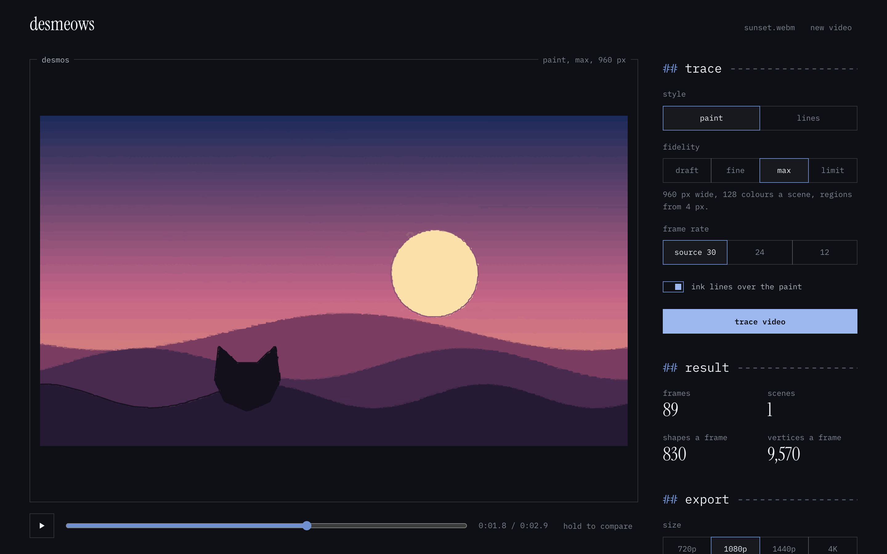

# desmeows

Any video, redrawn in Desmos.

**[desmeows.vercel.app](https://desmeows.vercel.app)**



Drop in a video and every frame becomes coloured polygons in a live
[Desmos](https://www.desmos.com/calculator) graph. Play it, scrub it, hold to compare it
against the original frame, then export it as an mp4 (up to 4K, with the original sound)
or save it as a standalone page that plays on its own.

It all runs in your browser. The video is never uploaded anywhere.

## How it works

1. **Decode.** The video is read in the page with [mediabunny](https://github.com/Vanilagy/mediabunny)
   over WebCodecs, at the frame rate you pick.
2. **Find scenes.** Small thumbnails of every frame show where the cuts are, and each
   scene gets its own palette, mixed with k-means in Lab colour space.
3. **Trace.** Web workers split each frame into patches of colour and trace every patch
   as an exact polygon, filled with its true mean colour. Real ink lines go on top,
   traced as single centerlines.
4. **Draw.** Each frame becomes a few Desmos expressions: lists of polygons with a
   colour for every element, largest first, so smaller shapes paint over the ones
   beneath them.
5. **Export.** Workers draw each frame again at the output size, from the same polygons
   Desmos is given (or Desmos itself draws them, if you choose), WebCodecs encodes them
   to H.264, and the source's audio is copied across untouched.

The full pipeline, and what had to bend to fit inside Desmos, is in
[web/README.md](web/README.md).

## Styles and fidelity

**Paint** fills every region and comes closest to the real video. **Lines** draws only
the edges, each in its own colour, on black.

| Fidelity | Trace width | Colours a scene | Smallest region |
| --- | --- | --- | --- |
| draft | 480 px | 32 | 16 px |
| fine | 640 px | 64 | 8 px |
| max | 960 px | 128 | 4 px |
| limit | 1280 px | 255 | 2 px |

On a 21-second 1280×720 clip at 30 fps (638 frames, Chrome on an Apple-silicon Mac),
*fine* averages about 1,600 shapes and 17,000 vertices a frame and traces in 2.5
seconds; *limit* averages 16,500 shapes and 123,000 vertices a frame and traces in about
9 seconds. Exporting the *fine* trace at 1080p takes 2.5 seconds; the *limit* trace at
4K, about 11 seconds. The same video traces to the same shapes every time.

Desmos can't redraw thousands of shapes 30 times a second, so while a clip plays the
live graph draws each frame's largest 600 shapes (300 on phones), about 23 frames a
second of the clip's 30 at *fine*. Pause to see every shape. The export always draws all
of them.

## Run it locally

No build step and no dependencies to install. Module workers need a server, so opening
the file directly won't work:

```bash
python3 -m http.server 8780 --directory web
```

Then open [localhost:8780](http://localhost:8780).

It needs a current Chrome, Edge, Firefox or Safari. The mp4 export also needs the
browser to encode H.264; where it can't, *save as page* still works.

## Deploy

The site is static and hosted on Vercel, connected to this repository with `web/` as
the project's root directory. Every push to `main` deploys to production at
[desmeows.vercel.app](https://desmeows.vercel.app); other branches and pull requests get
preview deployments. There is no build step: Vercel serves `web/` as it is.

### Desmos API key

The page uses the public demo key from the Desmos API docs, which is meant for testing
and shows a "trial key" notice on the live graph. For a site you share, get a key at
[desmos.com/api](https://www.desmos.com/api) and replace `apiKey=` in
`web/index.html`, and in `web/app.js` for saved pages.

## Repository

```
web/    the site: page, tracer, Desmos renderer, styles and fonts
v1/     the first version, a Python command-line prototype
docs/   images for this readme
```

[v1/](v1/README.md) is where desmeows started: an `ffmpeg` and OpenCV pipeline that
traces a video's edges into coloured lines and plays them in a local Desmos page.

## Credits

- Graphs drawn by the [Desmos API](https://www.desmos.com/api).
- Video decoding, encoding and muxing by [mediabunny](https://github.com/Vanilagy/mediabunny) (MPL-2.0).
- Type: [IBM Plex Mono](https://github.com/IBM/plex),
  [Instrument Serif](https://github.com/Instrument/instrument-serif) and
  [JetBrains Mono](https://github.com/JetBrains/JetBrainsMono), all under the SIL Open
  Font License 1.1; the licences are in `web/fonts/licenses/`.

## License

[MIT](LICENSE), except the fonts in `web/fonts/`, which keep their own SIL Open
Font License.
